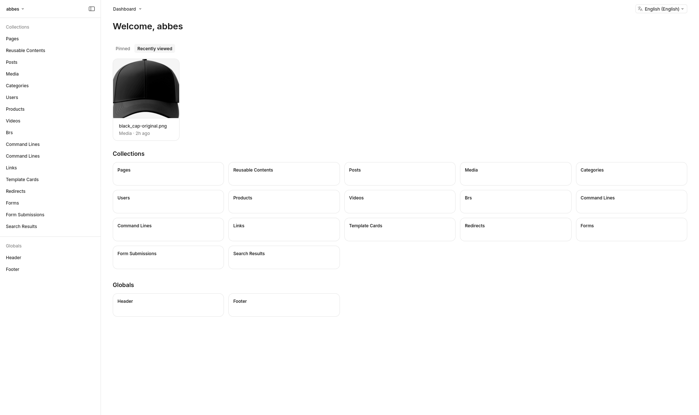

# Ecommerce Monorepo

A modern ecommerce stack built with Next.js (storefront + embedded Payload CMS) and Medusa.

## Payload Admin Panel

Manage pages, posts, media, and site navigation from the embedded Payload CMS admin panel.



## Architecture

- **`apps/store`**: Next.js storefront with embedded Payload CMS admin, consuming Medusa APIs.
- **`apps/medusa`**: Medusa backend for commerce logic (Products, Cart, Orders).
- **`packages/design-system`**: Shared shadcn/ui components and design system.
- **`packages/medusa`**: Shared Medusa client, types, and utilities.
- **`packages/db`**: Shared database infrastructure (Docker, migrations).
- **`packages/config`**: Shared linting and TypeScript configuration.
- **`packages/env`**: Shared environment variable validation (Zod).

## Getting Started

### Prerequisites

- **Node.js** >= 24.22.1 (the storefront's engine requirement)
- **pnpm** 12.15.0 (pinned in `package.json`; `corepack enable && corepack install`)
- **Docker** (for PostgreSQL + Redis)

### Setup

```bash
# 1. Install dependencies
pnpm install

# 2. Configure environment
cp apps/medusa/.env.template apps/medusa/.env
cp apps/store/.env.template apps/store/.env
# Edit both .env files with your own secrets (keys, passwords, etc.)

# 3. Start databases (PostgreSQL on :5555, Redis on :6379)
node --run db:start

# 4. Run migrations and seed data
node --run db:setup

# 5. Start development servers
node --run dev
```

That's it. The apps are available at:

| App               | URL                                                                     |
| ----------------- | ----------------------------------------------------------------------- |
| Storefront        | http://localhost:3000                                                   |
| Medusa admin      | http://localhost:9100/app                                               |
| Payload CMS admin | http://localhost:3000/admin                                             |
| pgAdmin           | http://localhost:5050 (email: `admin@ecommerce.com`, password: `admin`) |

> **First Medusa login**: email `admin@medusajs.com`, password set via `MEDUSA_ADMIN_PASSWORD` in `apps/medusa/.env`.

The storefront and embedded Payload CMS share port **3000**. Set
`NEXT_PUBLIC_BASE_URL`, `NEXT_PUBLIC_SERVER_URL`, and `PAYLOAD_SERVER_URL` in
`apps/store/.env` to `http://localhost:3000`. In `apps/medusa/.env`, use the same
`PAYLOAD_SERVER_URL` and include `http://localhost:3000` in `STORE_CORS` and
`AUTH_CORS`, as shown in the environment templates.

After changing these values, restart the affected development servers. Request a
new password-reset email: previously sent links retain their original URL.

## Deployment

The project has two admin interfaces that are best kept separate:

| Admin                        | Hosting                          | Path                                                                             |
| ---------------------------- | -------------------------------- | -------------------------------------------------------------------------------- |
| **Medusa** (commerce engine) | Subdomain like `api.example.com` | `/app` — the admin at `/app` avoids conflicts with store API routes (`/store/*`) |
| **Payload CMS** (content)    | Same domain as the storefront    | `/admin` — embedded in the Next.js app                                           |

Medusa on a subdomain isolates the commerce backend from the customer-facing site, avoids route conflicts with Payload's `/admin`, and has no SEO impact (admin interfaces aren't indexed).

## Key Scripts

- `node --run dev`: Start all apps in parallel.
- `node --run dev:store`: Start only the storefront.
- `node --run dev:medusa`: Start only the Medusa backend.
- `node --run check`: Run linting and formatting (Ultracite).
- `node --run db:start` / `node --run db:stop` / `node --run db:down`: Manage Docker services.
- `node --run db:setup`: Reset and scaffold all databases.

## Dependency versions

`pnpm-workspace.yaml` is the source of truth for shared dependency versions:

- Use `workspace:*` for internal `@ecommerce/*` dependencies. Each consumer must
  declare its own dependencies; do not rely on packages installed at the root.
- Use `catalog:` for shared libraries, including the exact React/React DOM pair
  and their types. `catalogMode: strict` rejects conflicting default-catalog
  versions when adding dependencies; it is not a full manifest linter.
- Use `catalog:medusa`, `catalog:mikro-orm`, and `catalog:payload` for coordinated
  framework releases. Upgrade each family together; Medusa UI has a separate
  version from the commerce packages.
- `catalog:storefront` keeps Next.js and the storefront's existing TypeScript 7
  version explicit. Other packages retain TypeScript 6 from the default catalog.
- App-specific dependencies may keep local version ranges. Repository tooling
  belongs in the root; avoid floating `latest` tags.

Run installs from the repository root. For example:

```bash
pnpm --filter store add 'react@catalog:'
pnpm --filter @ecommerce/medusa add '@medusajs/js-sdk@catalog:medusa'
pnpm install --frozen-lockfile # CI
pnpm peers check
```

Edit coordinated version sets in `pnpm-workspace.yaml`, run `pnpm install`, and
commit the manifest and lockfile together. `node --run bump-deps` uses pnpm's
interactive updater instead of rewriting manifests with npm-check-updates.
In pnpm 12, `.npmrc` is for registry/auth configuration only; build approvals and
other workspace settings belong in `pnpm-workspace.yaml`.

### Known compatibility gaps

Centralizing versions does not resolve existing upstream peer incompatibilities:
Medusa UI/draft-order expect React 18, the Medusa UI preset expects Tailwind 3,
Payload expects GraphQL 16 (currently 17), and several telemetry packages require
OpenTelemetry API below 1.10 (currently 1.10). The transitive `cva` package also
requires TypeScript below 6. `pnpm peers check` reports these and additional
transitive peer warnings. Resolve these through tested framework migrations;
do not hide them with broad overrides or peer-warning suppression.

---

_Built by merging [nextjs-starter-medusa](https://github.com/medusajs/nextjs-starter-medusa) with Payload's [website template](https://github.com/payloadcms/payload/tree/main/templates/website), scaffolded via [create-better-t-stack](https://github.com/AmanVarshney01/create-better-t-stack)._
